<h1 align="center">CanSat EDF Rocket with ATmega128</h1>

<p align="center"><a href="README.md">한국어</a> · <b>English</b></p>

<p align="center">
  A 3D-printed launch vehicle that carries a CanSat on a single 90 mm electric ducted fan (EDF)
</p>

<p align="center"><sub>This is the version whose flight computer is built on the <b>ATmega128</b>. STM32 and FPGA versions are developed separately.</sub></p>

<p align="center">
  
  
  
  
  
  
</p>

The rocket climbs vertically on EDF thrust, opens the nose cone at apogee to release the CanSat, and comes down on a parachute.
Attitude is held by four exhaust vanes, and the flight computing is shared by four ATmega128A chips on one carrier PCB.

## Overview

| Part | Description |
|---|---|
| Airframe | 3D-printed PLA (Bambu P2S), designed in CadQuery |
| Propulsion | Hobbyocean 90 mm 12-blade EDF, 6S 1450KV |
| Attitude control | 4 exhaust vanes, direct-drive MG90S servos |
| Flight computer | ATmega128A × 4 (NAV · FCU · COM · GNS) on the [carrier PCB rev 3.1](#avionics-carrier-pcb-rev-31) |
| Sensors · radio | GY-521 IMU, BMP280 barometer, NEO-7M GPS, OpenLog logger, ESP-12F (ESP-NOW) |
| Recovery | nose ejection at apogee → CanSat release, the vehicle descends on a parachute |

<sub>Labels next to numbers: M = measured by a tool, E = estimate, A = assumption</sub>

## New body v1.0 (CAD v2)

| Item | Value | Kind |
|---|---|:-:|
| Mass (without CanSat) | 2,089 g (CAD solids) / 2,053 g (slicer) | E |
| Thrust | EDF maximum thrust 17.9-19.3 N (2026-11-18 bench estimate), T/W 0.954-0.969 at 20 N | E |
| Static margin | nominal +1.09 cal (OpenRocket / RocketPy), +0.92 cal at the aft CG bound (49-51 g nose ballast) | M / E |

| 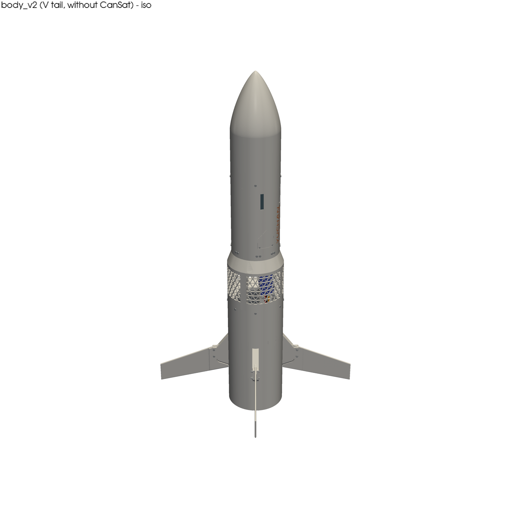 | 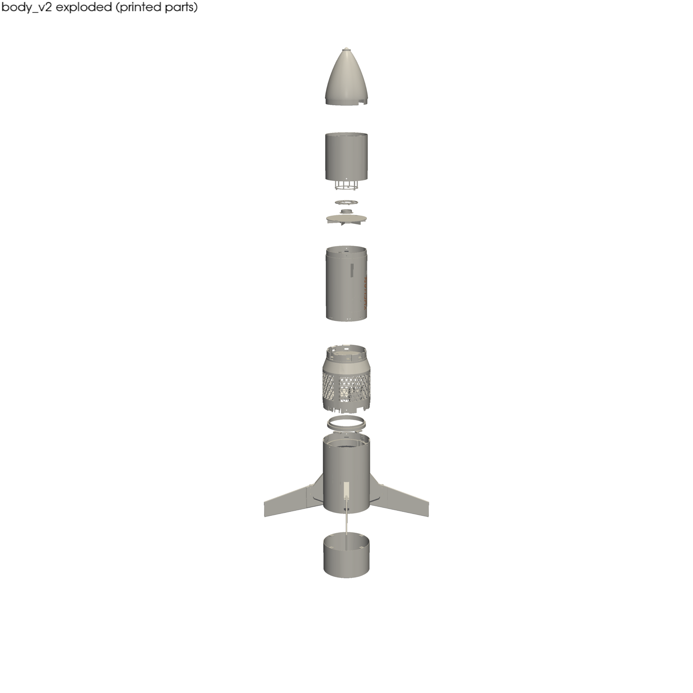 | 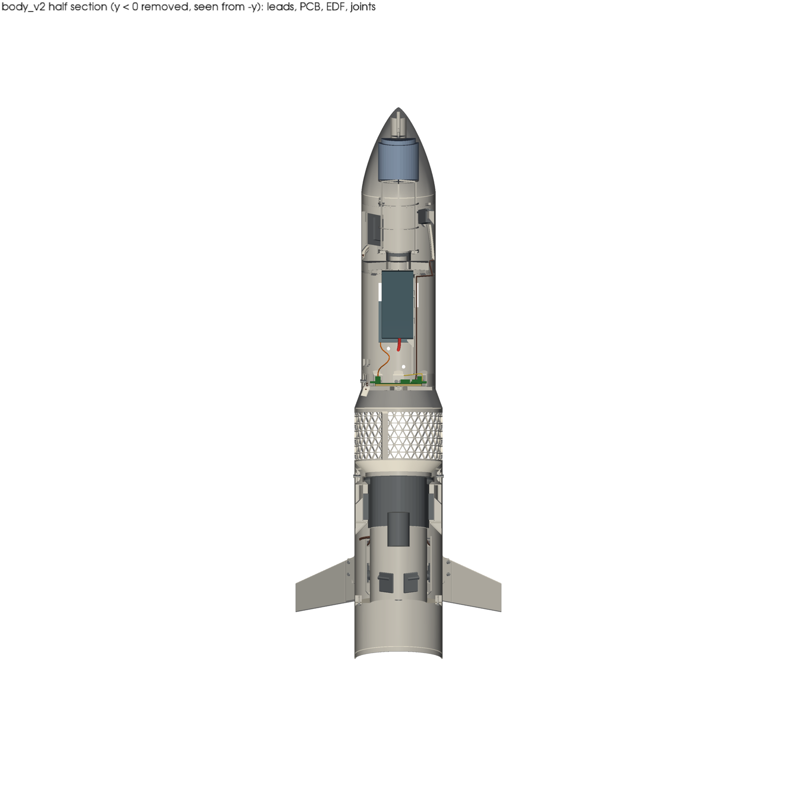 |
|:-:|:-:|:-:|
| <sub>Full model</sub> | <sub>Exploded view</sub> | <sub>Section</sub> |

## Block diagrams · flowcharts

The system, data flow, flight and ejection sequence and firmware states as figures (labels in Korean). Click a figure for its document. Full list: [docs/diagrams](docs/diagrams/README.md)

<p align="center"><a href="docs/diagrams/01_시스템_블록도.md"></a><br><sub><b>Figure 1-1. System block diagram</b></sub></p>
<p align="center"><a href="docs/diagrams/03_항공전자_데이터_블록도.md"></a><br><sub><b>Figure 3-1. Avionics data block diagram</b></sub></p>
<p align="center"><a href="docs/diagrams/05_비행_순서도.md"></a><br><sub><b>Figure 5-1. Flight flowchart (pad to landing and recovery)</b></sub></p>
<p align="center"><a href="docs/diagrams/06_펌웨어_상태도.md"></a><br><sub><b>Figure 6-1. Firmware state diagram (UML)</b></sub></p>

<details>
<summary><b>More figures (11)</b></summary>

<p align="center"><a href="docs/diagrams/02_전기_전원_블록도.md">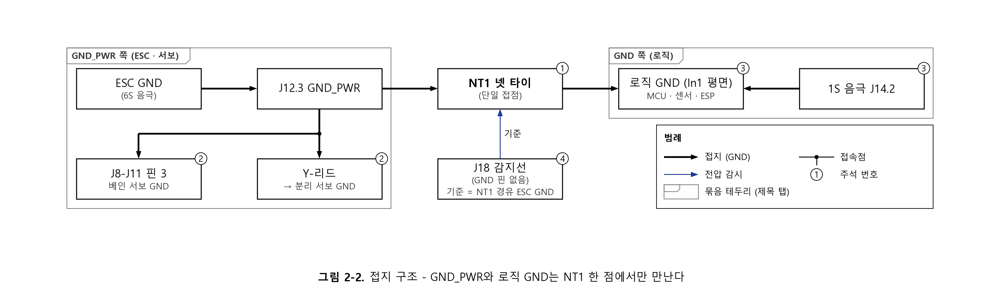</a><br><sub><b>Figure 2-2. Grounding</b></sub></p>
<p align="center"><a href="docs/diagrams/04_기계_구성도.md"></a><br><sub><b>Figure 4-1. Mechanical stack</b></sub></p>
<p align="center"><a href="docs/diagrams/04_기계_구성도.md"></a><br><sub><b>Figure 4-2. Wiring paths</b></sub></p>
<p align="center"><a href="docs/diagrams/06_펌웨어_상태도.md">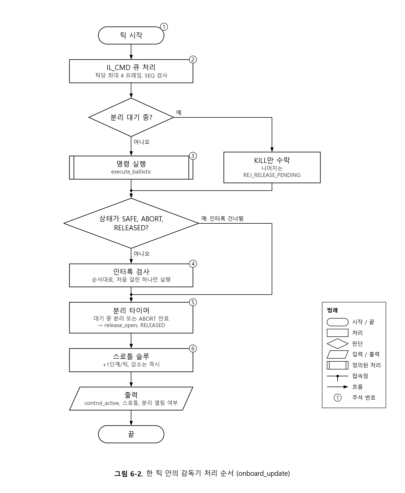</a><br><sub><b>Figure 6-2. One supervisor tick</b></sub></p>
<p align="center"><a href="docs/diagrams/07_제어_루프_순서도.md"></a><br><sub><b>Figure 7-1. One NAV tick</b></sub></p>
<p align="center"><a href="docs/diagrams/07_제어_루프_순서도.md"></a><br><sub><b>Figure 7-2. One FCU tick (control loop)</b></sub></p>
<p align="center"><a href="docs/diagrams/07_제어_루프_순서도.md">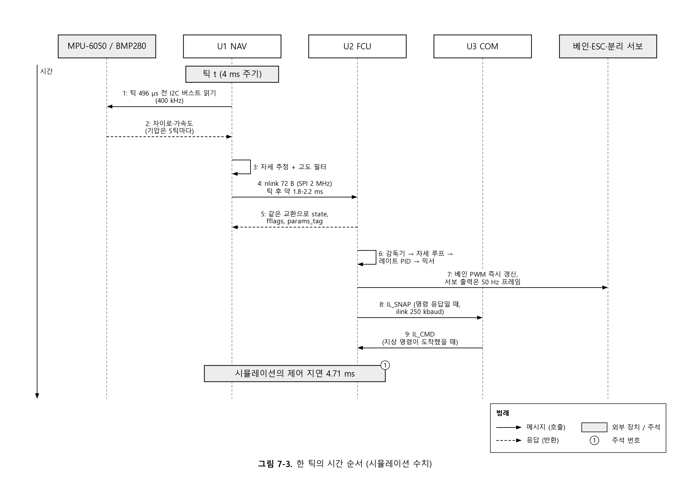</a><br><sub><b>Figure 7-3. Timing of one cycle</b></sub></p>
<p align="center"><a href="docs/diagrams/08_사출_순서도.md"></a><br><sub><b>Figure 8-1. Apogee ejection flowchart</b></sub></p>
<p align="center"><a href="docs/diagrams/08_사출_순서도.md"></a><br><sub><b>Figure 8-2. Ejection timing</b></sub></p>
<p align="center"><a href="docs/diagrams/09_개발_검증_흐름도.md"></a><br><sub><b>Figure 9-1. Development and verification flow</b></sub></p>
<p align="center"><a href="docs/diagrams/09_개발_검증_흐름도.md">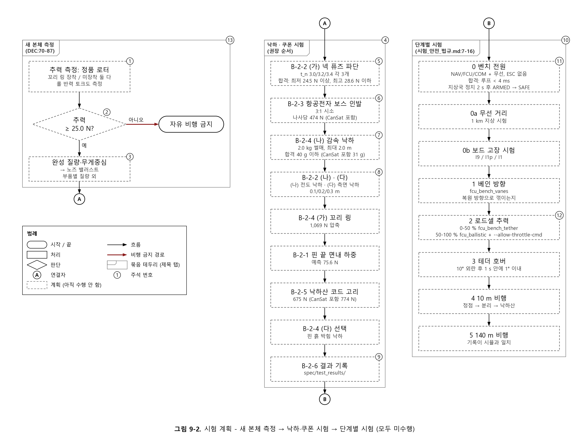</a><br><sub><b>Figure 9-2. Test plan</b></sub></p>

</details>

## Simulation

Flight performance and stability are cross-checked with OpenRocket, RocketPy, OpenFOAM (CFD) and the project's own 6-DOF simulator. [Validation report (Korean)](sim/validation_2026-11-18/README.md)

<p align="center">
  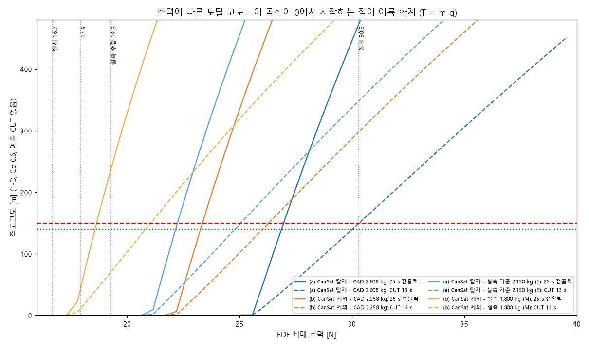<br>
  <sub>Apogee vs thrust</sub>
</p>

## EDF rotor (ground tests)

| 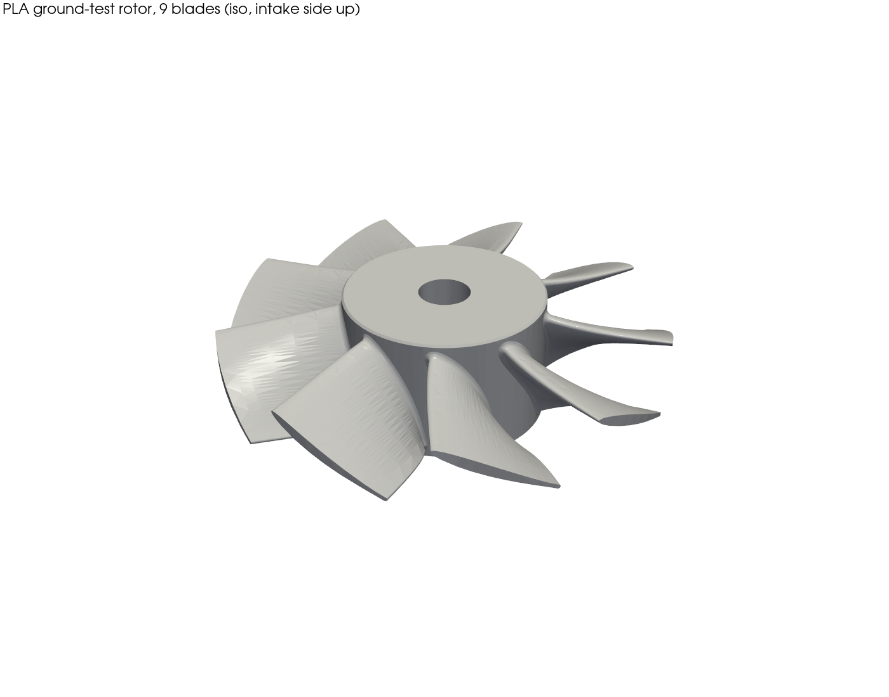 | 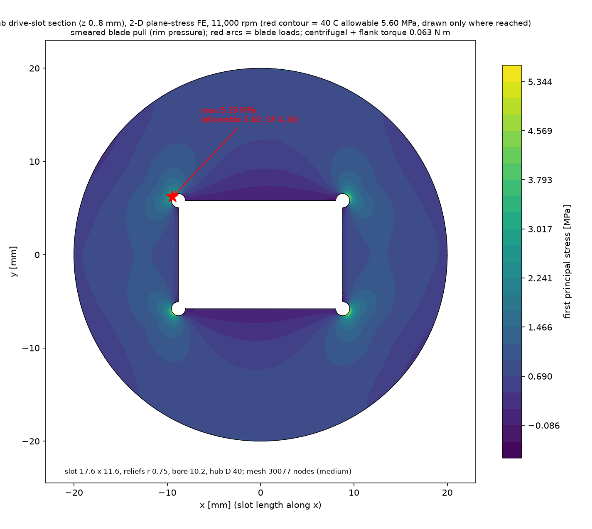 |
|:-:|:-:|
| <sub>9-blade PLA rotor</sub> | <sub>FE stress in the drive-slot section</sub> |

* A 9-blade PLA test rotor for the Hobbyocean 90 mm EDF, for ground tests only.
* Test cap 11,000 rpm, safety factor 4.16 (E).
* [Design](docs/EDF_로터_설계.md) · [test procedure](docs/EDF_로터_시험절차.md) (Korean)

## Avionics carrier PCB rev 3.1

A 4-layer board carrying the four flight-computer chips, sensors, Wi-Fi and logger, designed with KiCad 10 and Freerouting.

| 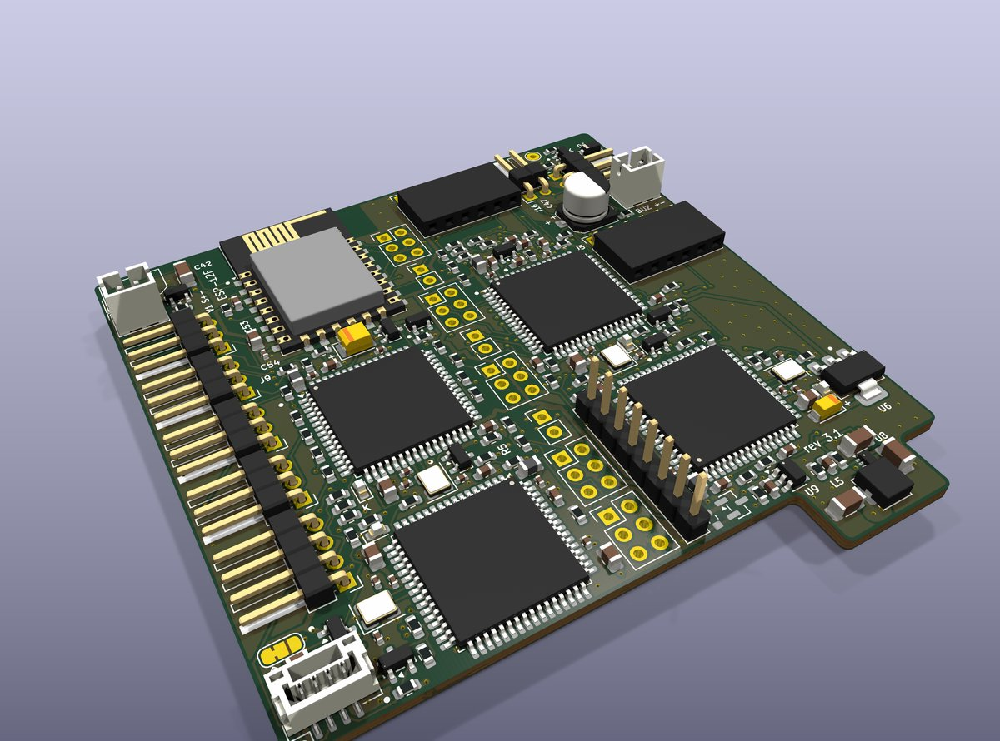 | 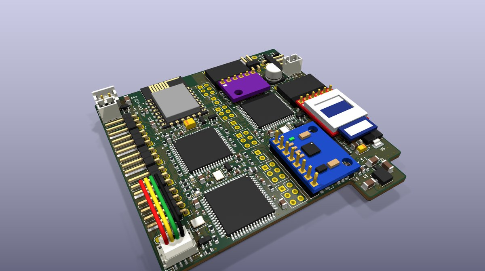 |
|:-:|:-:|
| <sub>Top 3/4 render</sub> | <sub>With modules: 4 MCUs, ESP-12F, GY-521, BMP280, OpenLog, GPS plug</sub> |

<p align="center">
  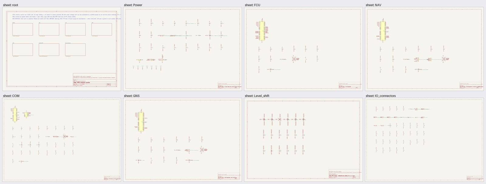<br>
  <sub>Eight schematic sheets (top, power, FCU, NAV, COM, GNS, level shifters, connectors)</sub>
</p>

| Item | Value |
|---|---|
| Size | 76 × 77.2 mm, 1.6 mm thick, 4 layers (signal / GND / +5V / signal) |
| Flight computer | ATmega128A-AU × 4 (NAV · FCU · COM · GNS), 16 MHz, 5 V |
| Radio | ESP-12F (ESP8266, ESP-NOW) |
| Sensors · logger | GY-521 (IMU), BMP280 (pressure), OpenLog, NEO-7M GPS |
| Power | 1S logic battery → reverse-polarity protection → 5 V boost (TPS61023) + undervoltage cut-off → 3.3 V (AMS1117) |

* Tool checks (kicad-cli 10.0.6): ERC 0, DRC 0, routing rules 21 / 21
* Details (Korean): [PCB README](pcb/vtol_carrier/README_ko.md)

## Firmware · ground station

* **Flight firmware** ([firmware/atmega128_fc](firmware/README.md), Korean): four ATmega128A chips (NAV attitude estimate and altitude filter, FCU supervisor, attitude control and servo/ESC, COM radio and telemetry, GNS GPS), avr-gcc + PlatformIO
* **Radio bridge**: [firmware/esp_bridge](firmware/esp_bridge/README.md) (ESP8266 ESP-NOW)
* **Ground station** (`tools/ground_station.py`): launch / motor cut / nose release commands, telemetry, logging, practice mode. [Usage (Korean)](docs/지상국_사용법.md)

```bash
python tools/ground_station.py --sim          # practice mode (virtual vehicle)
python tools/ground_station.py --port COM5    # real link
```

## YUCHAN logo

<p align="center">
  <br>
  <sub>Logo running vertically along the vehicle axis, printed in two colours on a P2S + AMS</sub>
</p>

## Folder structure

| Path | Contents |
|---|---|
| [`cad/body_v2/`](cad/body_v2/) | New body v1.0 CAD (STEP / STL), renders |
| [`cad/exports/rotor/`](cad/exports/rotor/) | Ground-test EDF rotor |
| [`pcb/vtol_carrier/`](pcb/vtol_carrier/) | Carrier PCB rev 3.1 (KiCad project, Gerber / BOM / CPL, renders) |
| [`firmware/`](firmware/) | ATmega128A four-chip firmware, ESP-NOW bridge |
| [`tools/ground_station.py`](tools/ground_station.py), [`sim/`](sim/) | Ground station and simulation modules |
| [`sim/validation_2026-11-18/`](sim/validation_2026-11-18/README.md) | Simulation validation report |
| [`docs/`](docs/) | Block diagrams and flowcharts, specification, test / safety / regulations, rotor design |
| `params.json` | Design values (read by the firmware config and the ground station) |

## License

[CC BY-NC 4.0](https://creativecommons.org/licenses/by-nc/4.0/) - share and adapt for non-commercial purposes with attribution. See [LICENSE](LICENSE). Third-party material follows its own license.
