<h1 align="center">CanSat EDF Rocket with ATmega128</h1>

<p align="center"><b>한국어</b> · <a href="README.en.md">English</a></p>

<p align="center">
  90 mm 덕티드팬(EDF) 하나로 캔위성을 싣고 올라가는 3D 프린트 발사체
</p>

<p align="center"><sub>비행 컴퓨터를 <b>ATmega128</b>로 만드는 판입니다. STM32 판과 FPGA 판은 따로 개발합니다.</sub></p>

<p align="center">
  
  
  
  
  
  
</p>

로켓은 EDF 추력으로 수직 상승하고, 정점에서 노즈콘을 열어 캔위성을 내보낸 뒤 낙하산으로 내려옵니다.
자세는 배기구의 베인 4개로 잡고, 비행 계산은 캐리어 PCB 한 장에 올린 ATmega128A 칩 4개가 나눠 맡습니다.

## 구성

| 부분 | 내용 |
|---|---|
| 기체 | 3D 프린트 PLA (Bambu P2S), CadQuery로 설계 |
| 추진 | Hobbyocean 90 mm 12엽 EDF, 6S 1450KV |
| 자세 제어 | 배기 베인 4개, MG90S 서보 직접 구동 |
| 비행 컴퓨터 | ATmega128A × 4 (NAV · FCU · COM · GNS), [캐리어 PCB rev 3.1](#아비오닉스-캐리어-pcb-rev-31) |
| 센서 · 통신 | GY-521 IMU, BMP280 기압계, NEO-7M GPS, OpenLog 로거, ESP-12F (ESP-NOW) |
| 회수 | 정점에서 노즈 사출 → 캔위성 분리, 기체는 낙하산으로 하강 |

<sub>숫자 옆 표시: M = 도구로 잰 값, E = 추정, A = 가정</sub>

## 새 본체 v1.0 (CAD v2)

| 항목 | 값 | 종류 |
|---|---|:-:|
| 질량 (CanSat 없이) | 2,089 g (CAD 고체) / 2,053 g (슬라이서) | E |
| 추력 | EDF 최대 추력 17.9-19.3 N (2026-11-18 벤치 추정), 20 N에서 T/W 0.954-0.969 | E |
| 정적 안정 여유 | 명목 +1.09 cal (OpenRocket / RocketPy), 무게중심 뒤 경계에서 +0.92 cal (코 추 49-51 g) | M / E |

| 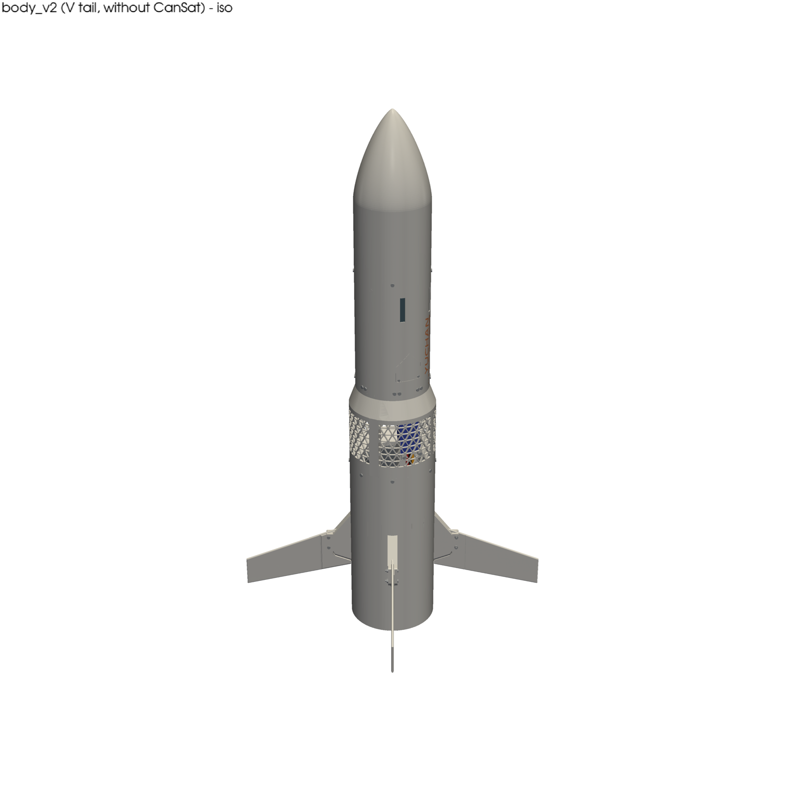 | 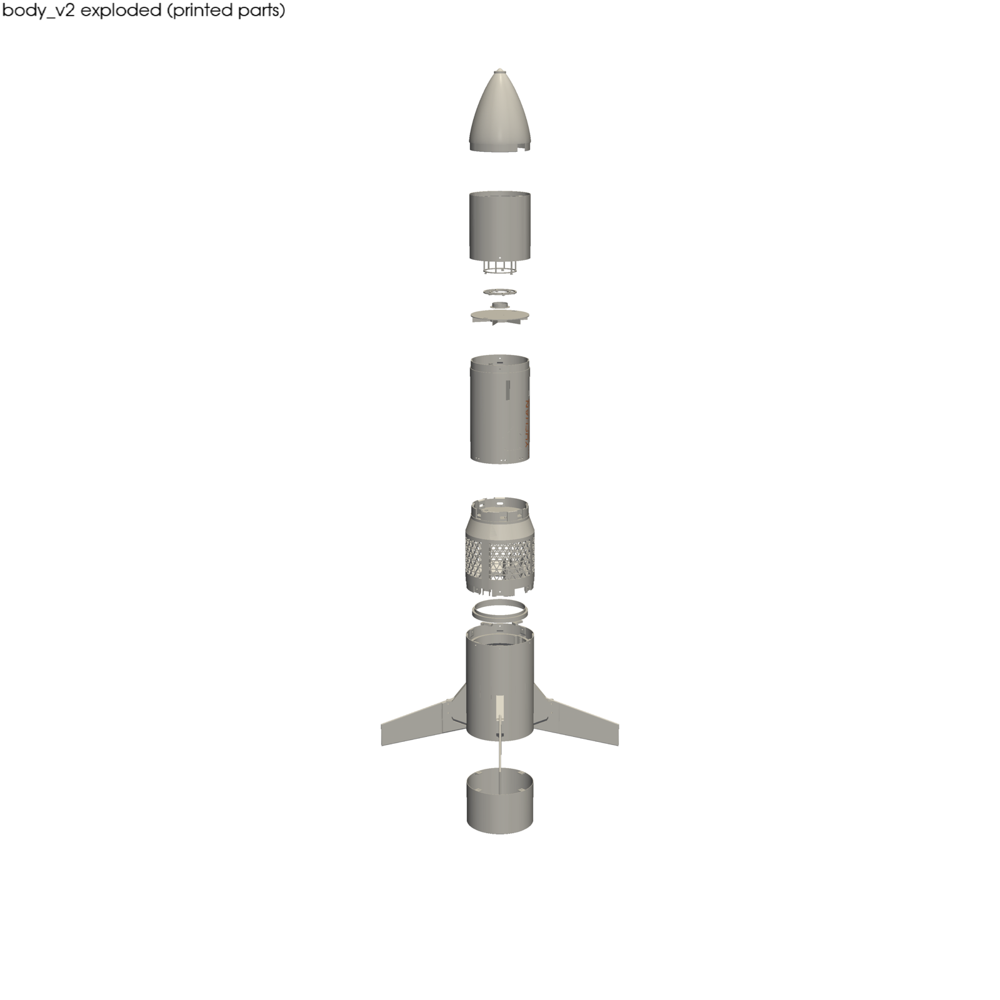 | 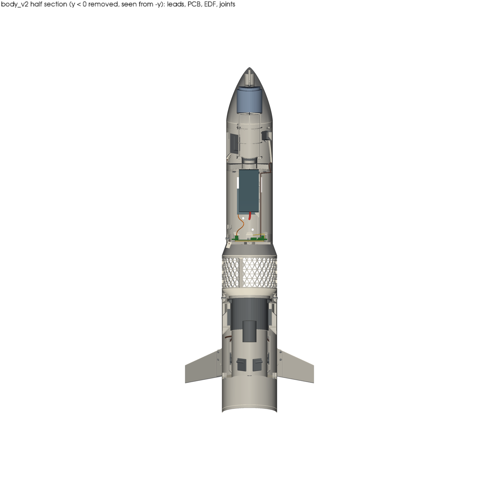 |
|:-:|:-:|:-:|
| <sub>전체 모델</sub> | <sub>분해도</sub> | <sub>단면</sub> |

## 블록도 · 순서도

시스템 구성, 데이터 흐름, 비행·사출 순서, 펌웨어 상태를 그림으로 나타냈습니다. 그림을 누르면 설명 문서로 이동합니다. 전체 목록: [docs/diagrams](docs/diagrams/README.md)

<p align="center"><a href="docs/diagrams/01_시스템_블록도.md"></a><br><sub><b>그림 1-1. 시스템 블록도</b></sub></p>
<p align="center"><a href="docs/diagrams/03_항공전자_데이터_블록도.md"></a><br><sub><b>그림 3-1. 항공전자 데이터 블록도</b></sub></p>
<p align="center"><a href="docs/diagrams/05_비행_순서도.md"></a><br><sub><b>그림 5-1. 비행 순서도 (발사대 → 착지·회수)</b></sub></p>
<p align="center"><a href="docs/diagrams/06_펌웨어_상태도.md">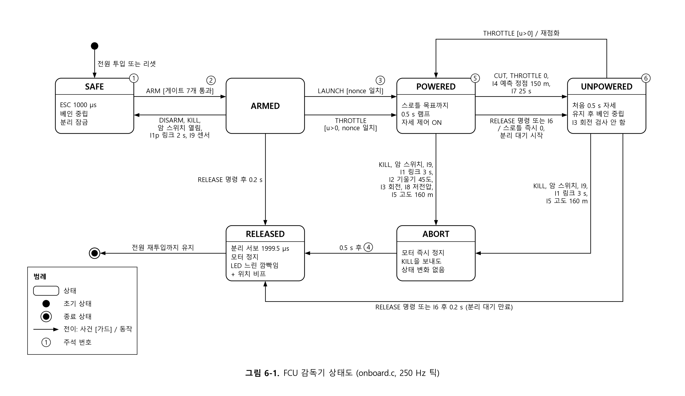</a><br><sub><b>그림 6-1. 펌웨어 상태도 (UML)</b></sub></p>

<details>
<summary><b>그림 더 보기 (11장)</b></summary>

<p align="center"><a href="docs/diagrams/02_전기_전원_블록도.md"></a><br><sub><b>그림 2-2. 접지 구조</b></sub></p>
<p align="center"><a href="docs/diagrams/04_기계_구성도.md"></a><br><sub><b>그림 4-1. 기계 구성 (적층 순서)</b></sub></p>
<p align="center"><a href="docs/diagrams/04_기계_구성도.md"></a><br><sub><b>그림 4-2. 배선 경로</b></sub></p>
<p align="center"><a href="docs/diagrams/06_펌웨어_상태도.md"></a><br><sub><b>그림 6-2. 감독기 한 틱 처리 순서</b></sub></p>
<p align="center"><a href="docs/diagrams/07_제어_루프_순서도.md"></a><br><sub><b>그림 7-1. NAV 한 틱</b></sub></p>
<p align="center"><a href="docs/diagrams/07_제어_루프_순서도.md">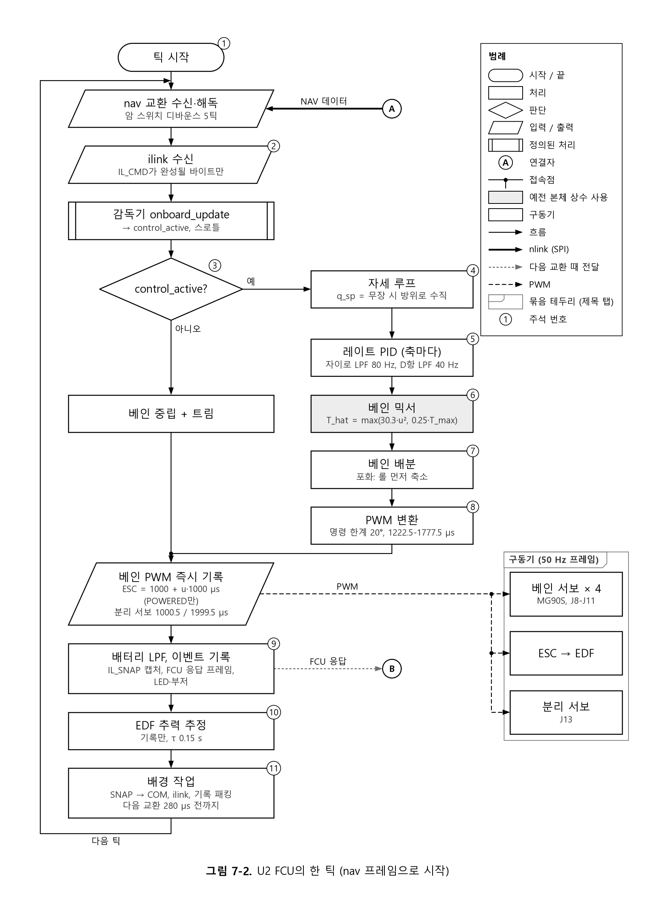</a><br><sub><b>그림 7-2. FCU 한 틱 (제어 루프)</b></sub></p>
<p align="center"><a href="docs/diagrams/07_제어_루프_순서도.md"></a><br><sub><b>그림 7-3. 한 주기 시간 순서</b></sub></p>
<p align="center"><a href="docs/diagrams/08_사출_순서도.md"></a><br><sub><b>그림 8-1. 정점 사출 순서도</b></sub></p>
<p align="center"><a href="docs/diagrams/08_사출_순서도.md"></a><br><sub><b>그림 8-2. 사출 시간 순서</b></sub></p>
<p align="center"><a href="docs/diagrams/09_개발_검증_흐름도.md"></a><br><sub><b>그림 9-1. 개발·검증 흐름도</b></sub></p>
<p align="center"><a href="docs/diagrams/09_개발_검증_흐름도.md"></a><br><sub><b>그림 9-2. 시험 계획</b></sub></p>

</details>

## 시뮬레이션

OpenRocket, RocketPy, OpenFOAM(CFD)과 자체 6-DOF 시뮬레이터로 비행 성능과 안정성을 교차 확인합니다. [검증 보고서](sim/validation_2026-11-18/README.md)

<p align="center">
  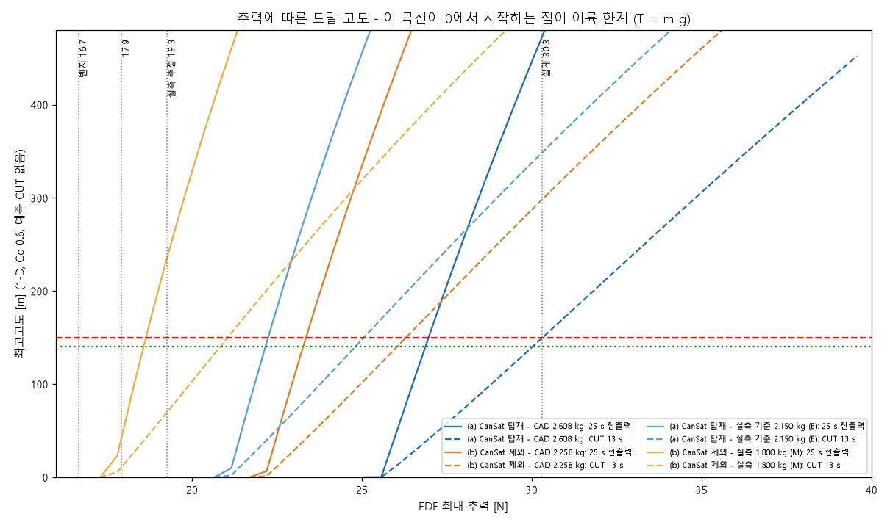<br>
  <sub>추력별 도달 고도</sub>
</p>

## EDF 로터 (지상 시험용)

| 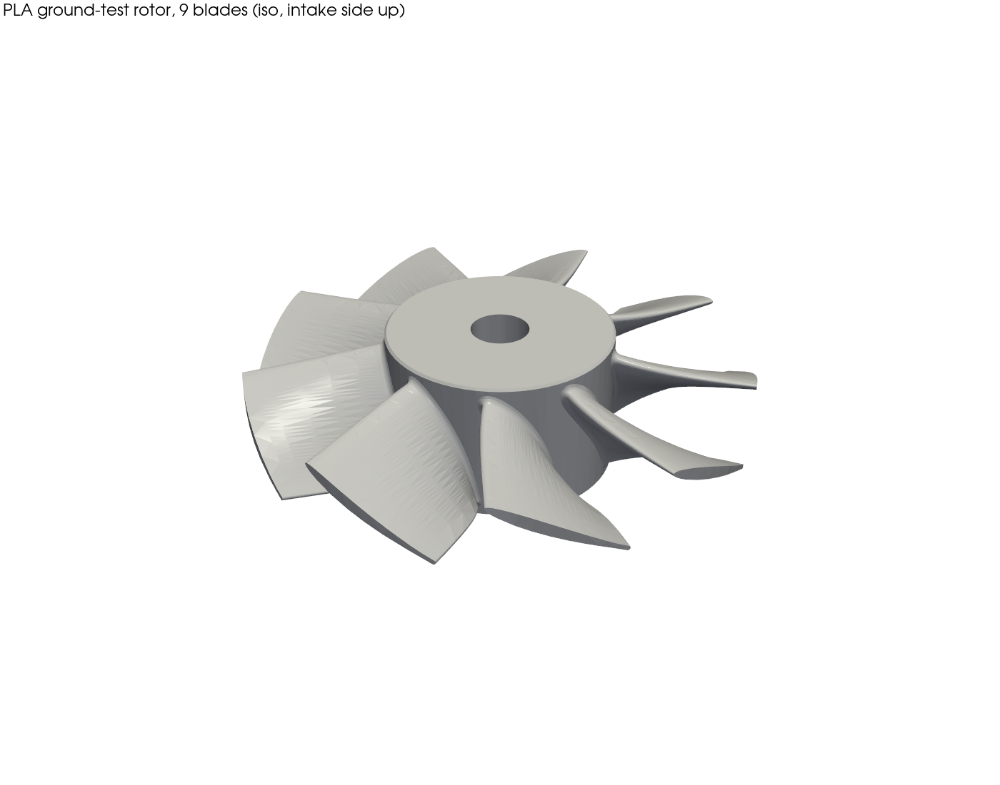 | 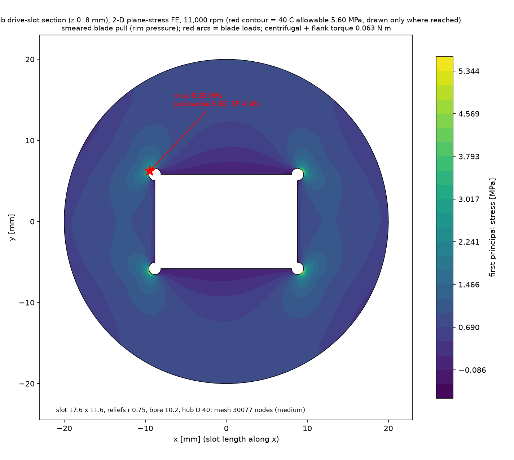 |
|:-:|:-:|
| <sub>9엽 PLA 로터</sub> | <sub>구동 홈 단면 FE 응력</sub> |

* Hobbyocean 90 mm EDF용 9엽 PLA 시험 로터입니다. 지상 시험에만 씁니다.
* 시험 상한 11,000 rpm, 안전계수 4.16 (E).
* [설계](docs/EDF_로터_설계.md) · [시험 절차](docs/EDF_로터_시험절차.md)

## 아비오닉스 캐리어 PCB rev 3.1

비행 컴퓨터 칩 4개, 센서, Wi-Fi, 로거를 한 장에 올린 4층 PCB입니다. KiCad 10과 Freerouting으로 설계했습니다.

| 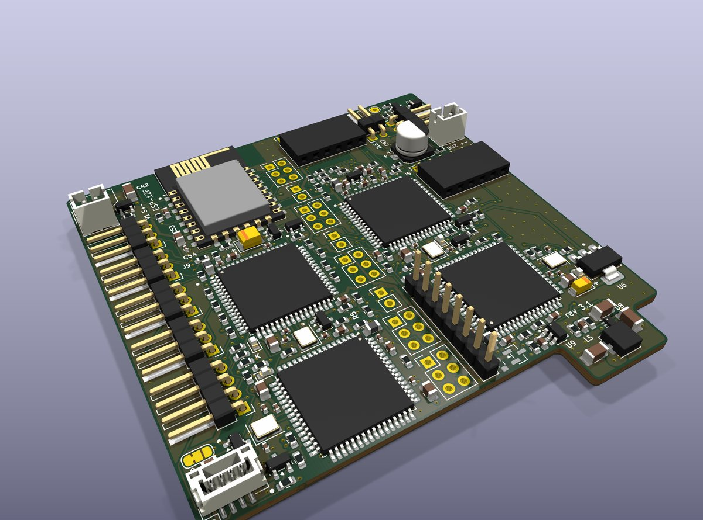 | 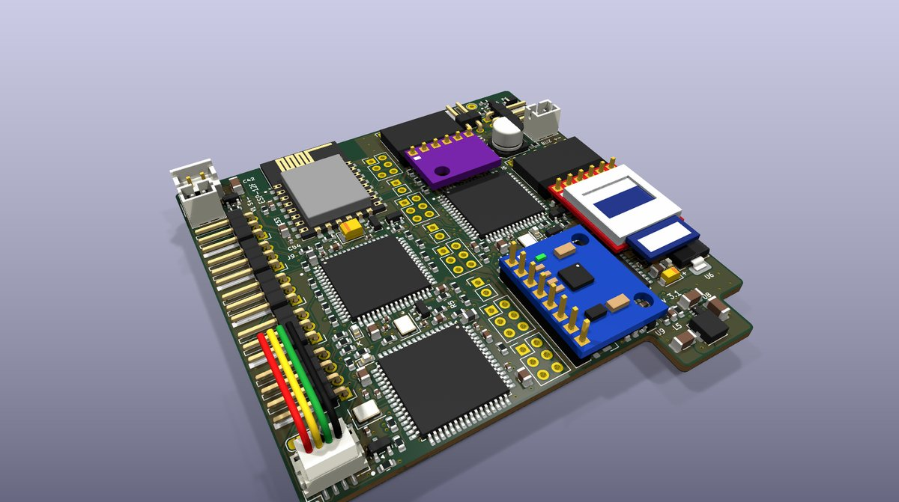 |
|:-:|:-:|
| <sub>윗면 3/4 렌더</sub> | <sub>모듈 장착 렌더: MCU 4개, ESP-12F, GY-521, BMP280, OpenLog, GPS 플러그</sub> |

<p align="center">
  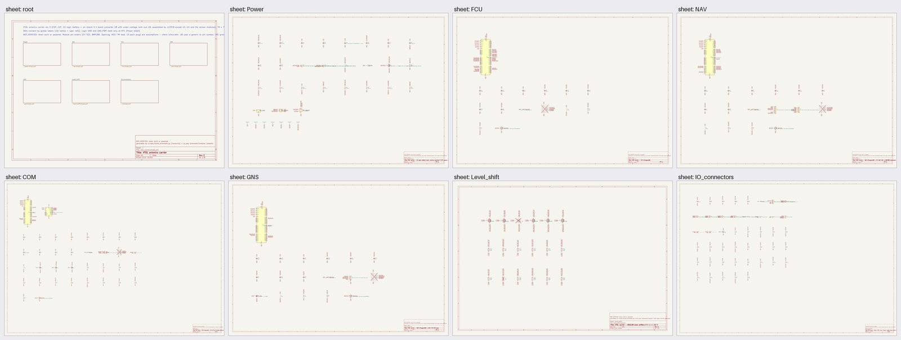<br>
  <sub>회로도 8장 (최상위, 전원, FCU, NAV, COM, GNS, 레벨 시프터, 커넥터)</sub>
</p>

| 항목 | 값 |
|---|---|
| 크기 | 76 × 77.2 mm, 두께 1.6 mm, 4층 (신호 / GND / +5V / 신호) |
| 비행 컴퓨터 | ATmega128A-AU × 4 (NAV · FCU · COM · GNS), 16 MHz, 5 V |
| 무선 | ESP-12F (ESP8266, ESP-NOW) |
| 센서 · 로거 | GY-521 (IMU), BMP280 (기압), OpenLog, NEO-7M GPS |
| 전원 | 1S 로직 배터리 → 역극성 보호 → 5 V 승압 (TPS61023) + 저전압 차단 → 3.3 V (AMS1117) |

* 도구 검사 (kicad-cli 10.0.6): ERC 0, DRC 0, 배선 규칙 21 / 21
* 자세한 내용: [PCB README](pcb/vtol_carrier/README_ko.md)

## 펌웨어 · 지상국

* **비행 펌웨어** ([firmware/atmega128_fc](firmware/README.md)): ATmega128A 4칩 (NAV 자세 추정·고도 필터, FCU 감독·자세 제어·서보/ESC, COM 무선·텔레메트리, GNS GPS), avr-gcc + PlatformIO
* **무선 브리지**: [firmware/esp_bridge](firmware/esp_bridge/README.md) (ESP8266 ESP-NOW)
* **지상국** (`tools/ground_station.py`): 발사·모터 정지·노즈 분리 명령, 텔레메트리, 로그, 연습 모드. [사용법](docs/지상국_사용법.md)

```bash
python tools/ground_station.py --sim          # 연습 모드 (가상 기체)
python tools/ground_station.py --port COM5    # 실제 연결
```

## YUCHAN 로고

<p align="center">
  <br>
  <sub>기체 축을 따라 세로로 들어가는 로고, P2S + AMS 2색 출력</sub>
</p>

## 폴더 구조

| 경로 | 내용 |
|---|---|
| [`cad/body_v2/`](cad/body_v2/) | 새 본체 v1.0 CAD (STEP / STL), 그림 |
| [`cad/exports/rotor/`](cad/exports/rotor/) | 지상 시험용 EDF 로터 |
| [`pcb/vtol_carrier/`](pcb/vtol_carrier/) | 캐리어 PCB rev 3.1 (KiCad 프로젝트, 거버·BOM·CPL, 렌더) |
| [`firmware/`](firmware/) | ATmega128A 4칩 펌웨어, ESP-NOW 브리지 |
| [`tools/ground_station.py`](tools/ground_station.py), [`sim/`](sim/) | 지상국과 시뮬레이션 모듈 |
| [`sim/validation_2026-11-18/`](sim/validation_2026-11-18/README.md) | 시뮬레이션 검증 보고서 |
| [`docs/`](docs/) | 블록도·순서도, 사양서, 시험·안전·법규, 로터 설계 |
| `params.json` | 설계값 (펌웨어 설정과 지상국이 읽음) |

## 라이선스

[CC BY-NC 4.0](https://creativecommons.org/licenses/by-nc/4.0/) - 출처를 밝히면 비상업적 목적으로 공유·수정할 수 있습니다. 자세한 내용은 [LICENSE](LICENSE). 다른 사람의 자료는 각자의 라이선스를 따릅니다.
